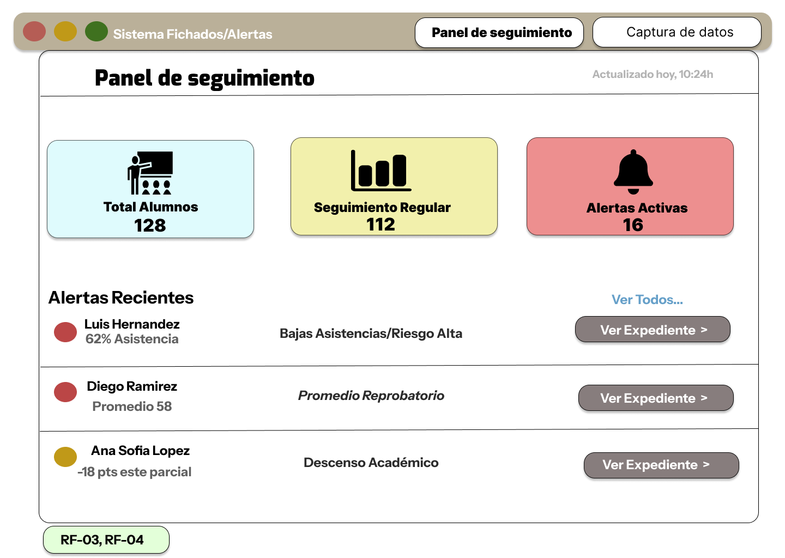
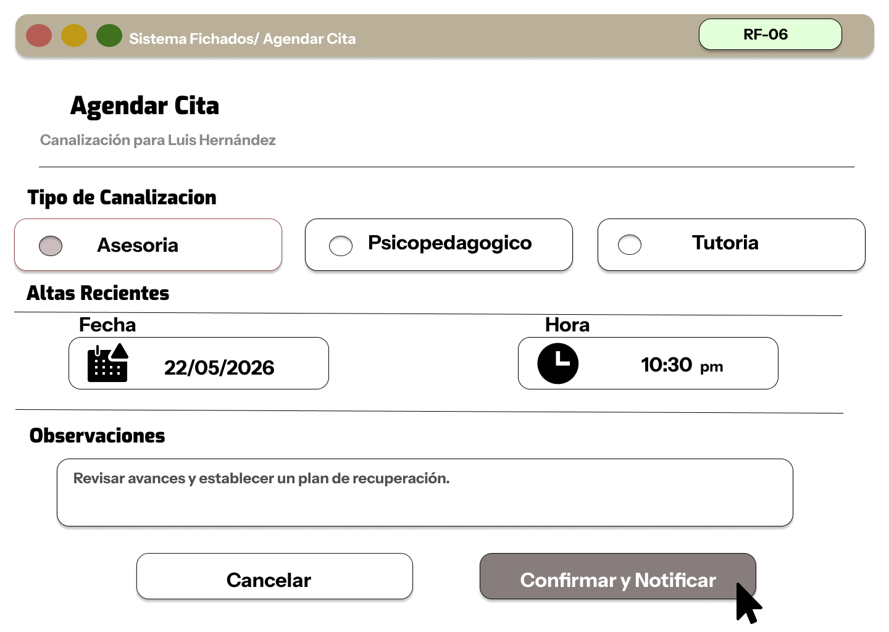
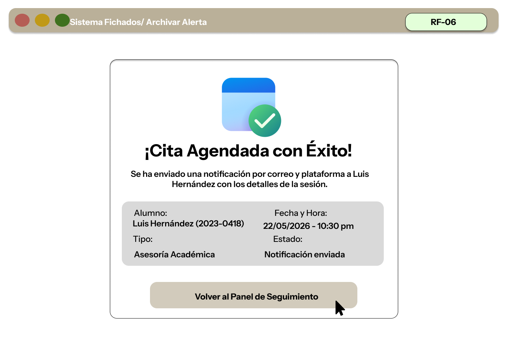
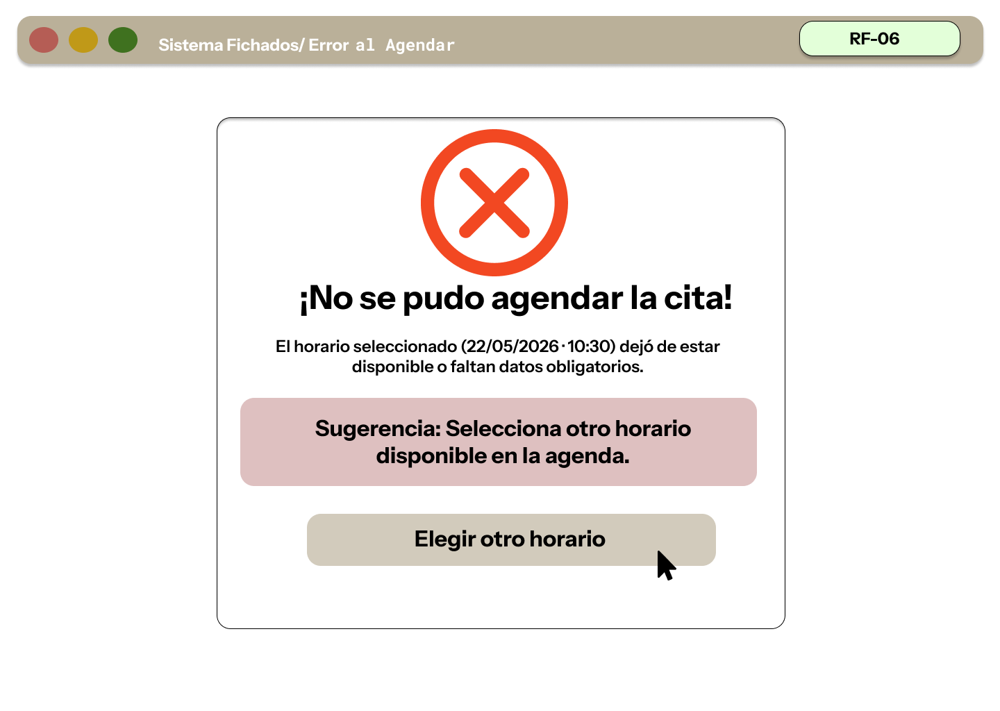
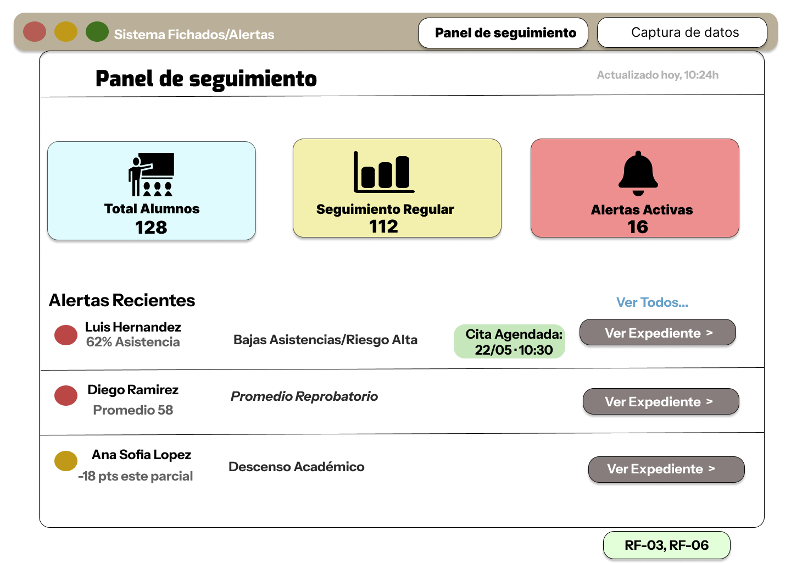

# U3 · Especificación de requisitos — Fichados

**Versión:** 0.2  
**Fecha:** [2026-11-18]  
**Equipo y roles:** Frida Sofía Zamora Quezada (Analisis) · Jocelyn Fernanda Pérez Muñoz (Desarrollo) · Karime Ortiz Reyes (Coordinacion) · Gilberto Juarez Hernández (Documentación)  
**Estado:** En elaboración

## A. Identificación y alcance

- Proyecto: Fichados – Sistema Inteligente de Gestión Estudiantil y Riesgo Académico.
- Proceso TO-BE seleccionado: Seguimiento académico de los estudiantes (proceso mejorado de la Unidad 2).
- Objetivo de esta especificación: Facilitar la consulta y el análisis de la información académica para identificar posibles señales de riesgo y ayudar al tutor a dar seguimiento a los estudiantes.
- Dentro del alcance:
  - Consultar calificaciones y asistencias.
  - Identificar materias no acreditadas.
  - Detectar posibles señales de riesgo académico.
  - Generar alertas para que el tutor revise los casos.
  - Conservar la información de participación extracurricular.
- Fuera del alcance:
  - Tomar decisiones automáticamente sobre los estudiantes.
  - Determinar por sí solo si un estudiante abandonará sus estudios.
  - Sustituir el trabajo del tutor.

### Aportaciones

| Nombre | Rol U3 | Dos IDs asignados | Enlace Trello / PR |
|---|---|---|---|
| Frida Sofía Zamora Quezada | coordinacion | RF-03, RF-04 | [enlace] |
| Jocelyn Fernanda Pérez Muñoz | Documentacion | RNF-02, RF-05| * https://trello.com/c/K483Qvei   *https://github.com/a241000191-collab/fis-2026-e03-Fichados/pull/1 |
| Karime Ortiz Reyes | Analisis| [IDs] | [enlace] |
| Gilberto Juarez Hernández | Documentación | RF-02, RF-06 | [enlace] |

## B. Fuentes y necesidades

### B1. Plan de obtención

| Pregunta por resolver | Persona o documento a consultar | Técnica | Responsable | Estado |
|---|---|---|---|---|
| ¿Qué criterios se usan para considerar que un estudiante está en riesgo? | Tutor académico y reglamento institucional | Entrevista o análisis documental |Frida Sofía Zamora Quezada | Pendiente |
| ¿Qué datos académicos y extracurriculares puede entregar la escuela, desde qué periodo y en qué formato? | Control escolar | Entrevista o análisis documental | Jocelyn Fernanda Pérez Muñoz | Pendiente |
| ¿Quién debe tener acceso a los datos de los estudiantes? | Control escolar | Entrevista | Karime Ortiz Reyes | Pendiente |
| ¿Cómo se registran hoy los cambios de club y se conserva la participación de un periodo a otro? | Responsable de actividades extracurriculares | Entrevista | Karime Ortiz Reyes | Pendiente |
| Cuando el tutor revisa a un estudiante en riesgo, ¿qué hace y cómo deja constancia de su decisión? | Tutor académico | Entrevista |Gilberto Juarez | Pendiente |
| Cuando falta una calificación o una asistencia, ¿cómo se detecta y quién la completa? | Control escolar y docentes | Entrevista | Gilberto Juarez | Pendiente |

### B2. Fuentes realmente consultadas

Para conocer cómo se realiza actualmente el seguimiento de los estudiantes, se tomó como referencia la información obtenida en las entrevistas realizadas al coordinador de división y al jefe de actividades extracurriculares.

<!-- Completar la fecha real y el respaldo de cada entrevista. Si no se pueden documentar, pasarlas al plan B1 y escribir «Sin fuentes confirmadas todavía». -->

| ID | Técnica | Fuente | Fecha de obtención | Hallazgo | Respaldo | Validación |
|---|---|---|---|---|---|---|
| F-01 | Entrevista | Coordinador de división | 22/OCT/2026 | Se da seguimiento a las calificaciones y al desempeño de los estudiantes. Las calificaciones y la asistencia se registran en un sistema; algunos docentes llevan las suyas en Excel y algunos ponen cero a quien no entregó nada. Los docentes envían sus listas al tutor y el tutor las concentra en un archivo de Excel; también se usan el Kardex y la retícula a color. | [enlace o ubicación del audio o notas] | Por validar |
| F-02 | Entrevista | Jefe de actividades extracurriculares | 22/OCT/2026 | Se lleva un seguimiento de las actividades extracurriculares. | [enlace o ubicación de las notas] | Por validar |

Antecedentes del equipo (no cuentan como fuentes confirmadas): propuesta inicial del proyecto (U1-E02) y documento de modelo de negocio con el AS-IS y el TO-BE (U2-E01).

### B3. Necesidades identificadas

| ID | Necesidad | Fuente que la respalda |
|---|---|---|
| N-01 | Facilitar la consulta de información académica. | F-01 |
| N-02 | Conservar la información de participación de los estudiantes. | F-02 |
| N-03 | Reducir el trabajo manual de concentrar en Excel las listas de varias materias. | F-01 |
| N-04 | Saber cuándo la información de un estudiante está incompleta antes de analizarla (respaldo parcial: un cero puede significar que no entregó o que no se registró). | F-01 |

### B4. Pendientes

| Duda | Fuente por consultar | Responsable |
|---|---|---|
| Qué datos pueden utilizarse en el sistema | Control escolar | Jocelyn Fernanda Pérez Muñoz |
| Qué registros extracurriculares están disponibles | Responsable de actividades extracurriculares | Karime Ortiz Reyes |
| Qué criterios definen a un estudiante en riesgo | Tutor académico y reglamento | Frida Sofía Zamora Quezada |
| Quién debe tener acceso a los datos y a las alertas | Control escolar | Karime Ortiz Reyes |
| Cómo deja constancia el tutor de su decisión sobre una alerta | Tutor académico | Gilberto Juarez Hernández |
| Si una alerta debe ser revisada por una persona antes de actuar | Tutor o coordinación | Frida Sofía Zamora Quezada |

## C. Organización del alcance

- Ruta elegida: B (directa), requisitos directos.
- Motivo de elección: El proceso está acotado y queremos trabajar directamente con las necesidades identificadas, convirtiéndolas en requisitos para el sistema, sin tener que desarrollar una épica.
- Proceso: Seguimiento académico de los estudiantes.
- Objetivo: Facilitar la consulta de la información académica y la identificación de posibles señales de riesgo.
- Requisitos vinculados: RF-01 a RF-06, RNF-01 y RNF-02 (propuestos, ver sección E).

Los requisitos se enfocarán principalmente en:

- Consulta de información académica.
- Identificación de posibles señales de riesgo.
- Conservación de información extracurricular.

## D. Reglas del dominio

| ID | Regla | Quién la establece | Origen en B2 | Estado |
|---|---|---|---|---|
| RG-01 | La información académica debe estar registrada para poder realizar un análisis. | Personal responsable de los registros académicos | F-01 (parcial) | Por validar |
| RG-02 | Una alerta de posible riesgo debe ser revisada por el tutor antes de tomar alguna decisión. | [por confirmar con el tutor o la coordinación] | Origen pendiente · ver B4 | Propuesto |
| RG-03 | La información extracurricular debe conservarse para poder consultar la participación de los estudiantes en diferentes periodos. | [por confirmar con el responsable de actividades extracurriculares] | F-02 (parcial) | Por validar |
| RG-04 | La institución define los criterios para considerar a un estudiante en riesgo (por ejemplo, inasistencias o materias reprobadas); los valores exactos están por confirmar. | Institución (tutor académico y reglamento) | Origen pendiente · ver B4 | Propuesto |

## E. Catálogo de requisitos

> RF y RNF se numeran por separado. Los IDs no indican orden de ejecución.

| ID | Tipo | Enunciado verificable | Origen (F / N) | Prioridad | Motivo | Autor | Estado |
|---|---|---|---|---|---|---|---|
| RF-01 | RF | El sistema debe permitir al personal administrativo y a los docentes cargar o sincronizar las calificaciones y asistencias de los estudiantes, sin duplicar registros. | F-01 / N-03 | P1 | Sin los datos cargados no hay información que centralizar ni analizar. | [autor] | Por validar |
| RF-02 | RF | El sistema debe mostrar un aviso cuando a un estudiante le falte una calificación o una asistencia necesaria para el análisis, y no debe analizarlo hasta que el dato se complete o se verifique. | F-01 / N-04 | P1 | Con datos incompletos el análisis puede generar una alerta incorrecta. | Gilberto Juarez Hernández | Por validar |
| RF-03 | RF | El sistema debe generar una alerta asociada a un alumno únicamente cuando sus indicadores cumplan los criterios de riesgo definidos. | Origen pendiente · ver B4 | P1 | Sin esta condición el sistema alertaría sin sustento o dejaría pasar casos. | Frida Sofia Zamora Quezada | Propuesto |
| RF-04 | RF | El sistema debe mostrar al tutor, junto con cada alerta, los indicadores que la originaron. | Origen pendiente · ver B4 | P1 | Sin ese detalle el tutor no puede evaluar el caso. | Frida Sofia Zamora Quezada | Propuesto |
| RF-05 | RF | El sistema debe permitir al tutor consultar, para un estudiante seleccionado, sus calificaciones, asistencias y materias no acreditadas. | F-01 / N-01 | P1 | Sin esta consulta el tutor no puede revisar el caso de un estudiante. | Jocelyn Fernanda Pérez Muñoz | Por validar |
| RF-06 | RF | El sistema debe permitir al tutor registrar, para cada alerta que recibe, si el estudiante requiere seguimiento o no, y guardar esa decisión con la fecha. | Origen pendiente · ver B4 | P1 | Cierra el proceso y permite medir cuántas alertas se revisan. | Gilberto Juarez Hernández | Propuesto |
| RNF-01 | RNF | El sistema debe permitir consultar los datos académicos y las alertas de un estudiante únicamente a usuarios autenticados con un rol autorizado (tutor asignado o personal administrativo). | Origen pendiente · ver B4 | P1 | Son datos personales de estudiantes y un acceso indebido sería un riesgo grave. | [autor] | Propuesto |
| RNF-02 | RNF | El sistema debe conservar la información de participación de los estudiantes en clubes y actividades extracurriculares y mantenerla disponible para consulta en los semestres siguientes, sin eliminarla automáticamente al terminar un periodo. | F-02 / N-02 | P2 | Aporta al objetivo de no volver a pedir la información, pero la primera versión puede generar alertas con los datos académicos. | Jocelyn Fernanda Pérez Muñoz | Por validar |

## F. Criterios de aceptación

| ID | Condición (Dado) | Acción (Cuando) | Resultado comprobable (Entonces) |
|---|---|---|---|
| RF-01 · éxito | Un archivo con calificaciones y asistencias válidas. | Un usuario autorizado lo carga. | Los datos quedan registrados en el sistema sin duplicar a ningún estudiante. |
| RF-01 · alternativa | Un archivo con un estudiante que ya estaba registrado. | Se carga el archivo. | Se actualiza su registro y no se crea uno nuevo. |
| RF-02 · éxito | A un estudiante le falta la calificación de una materia. | Se intenta realizar el análisis de su información. | Se muestra un aviso con el dato que falta y no se genera alerta para ese estudiante hasta completarlo o verificarlo. |
| RF-02 · alternativa | Un estudiante tiene completas sus calificaciones y asistencias. | Se realiza el análisis. | El análisis continúa sin mostrar el aviso. |
| RF-03 · éxito | Un alumno cuyos indicadores cumplen los criterios de riesgo [criterio por confirmar con el tutor]. | El sistema realiza el análisis. | Se genera una alerta asociada a ese alumno. |
| RF-03 · alternativa | Un alumno cuyos indicadores no cumplen los criterios de riesgo. | El sistema realiza el análisis. | No se genera alerta. |
| RF-04 · éxito | Un alumno con una alerta generada. | El tutor abre la alerta. | Ve la lista de indicadores que la originaron. |
| RF-04 · alternativa | El sistema no puede determinar los indicadores que originaron la alerta. | El tutor abre la alerta. | Aparece un aviso de que el detalle no está disponible. |
| RF-05 · éxito | Un estudiante registrado en el sistema. | El tutor lo busca y lo selecciona. | Ve sus calificaciones, asistencias y materias no acreditadas, que corresponden a ese estudiante. |
| RF-05 · alternativa | Un nombre o matrícula que no existe en el sistema. | El tutor lo busca. | El sistema indica que no se encontró al estudiante. |
| RF-06 · éxito | El tutor tiene una alerta recibida. | Marca si el estudiante requiere seguimiento o no. | Se guarda la decisión con la fecha y la alerta queda como revisada. |
| RF-06 · alternativa | Una alerta no tiene decisión registrada. | Se consulta su estado. | Aparece como pendiente de revisión. |
| RNF-01 · éxito | Un usuario autenticado con rol de tutor asignado al estudiante. | Consulta una alerta o los datos del estudiante. | Puede verlos. |
| RNF-01 · alternativa | Un usuario sin autenticar o sin rol autorizado. | Intenta consultar los datos de un estudiante. | El acceso se bloquea y se muestra un mensaje de acceso no autorizado. |
| RNF-02 · éxito | Terminó un semestre y hay registros de participación extracurricular. | Se consulta la información en el semestre siguiente. | Los registros del semestre anterior siguen disponibles. |
| RNF-02 · alternativa | Un estudiante cambió de club o dejó una actividad. | Se consulta su historial de participación. | El registro anterior sigue disponible y no se elimina automáticamente. |

## G. Backlog y boceto

### Orden de trabajo

| Orden | ID | P | Depende de | Trello |
|---|---|---|---|---|
| 1 | RF-01 | P1 | Ninguno | [URL] |
| 2 | RF-02 | P1 | RF-01 | [URL] |
| 3 | RF-05 | P1 | RF-01 | [Tarjeta Jocelyn (RF-05 / RNF-02)](https://trello.com/c/K483Qvei)    |
| 4 | RF-03 | P1 | RF-02 y criterios de riesgo (RG-04) | [URL] |
| 5 | RF-04 | P1 | RF-03 | [URL] |
| 6 | RF-06 | P1 | RF-04 | [URL] |
| 7 | RNF-01 | P1 | Ninguno (aplica a los requisitos que muestran datos) | [URL] |
| 8 | RNF-02 | P2 | RF-01 |[Tarjeta Jocelyn (RF-05 / RNF-02)](https://trello.com/c/K483Qvei) |

### Recorrido del usuario mediante wireframes de baja fidelidad

Borrador · pendiente de validar con Análisis y Desarrollo. Recorrido prioritario: el personal carga y verifica los datos de un estudiante, el sistema analiza y genera una alerta, y el tutor la consulta y registra su decisión. Son cuatro momentos representados con cinco estados; no se exige una pantalla independiente por estado.

| Estado | Qué muestra | Requisitos | Continúa en |
|---|---|---|---|
| 01 · Inicio | Pantalla de inicio con acceso por rol y las opciones «Cargar datos de un estudiante» y «Consultar alertas». | RF-01, RNF-01 | 02 |
| 02 · Acción | Se selecciona o se carga la información de un estudiante y se presiona «Analizar». | RF-01, RF-02 | 03A o 03B |
| 03A · Éxito | Los datos están completos: se muestra el análisis realizado y, si se cumplen los criterios de riesgo, se genera una alerta con folio. | RF-03 | 04 |
| 03B · Error | Falta una calificación o asistencia: aviso en texto con el dato faltante; no se analiza al estudiante. | RF-02 | 02 |
| 04 · Consulta | El tutor abre la alerta con su folio, ve los indicadores y los datos del estudiante, y registra su decisión. | RF-04, RF-05, RF-06 | Fin |

Flechas del recorrido: 01 → 02; 02 → 03A cuando los datos están completos; 02 → 03B cuando falta un dato; 03B → 02 para completar el dato; solo desde 03A se continúa al 04.

Nota: consultar la alerta por folio o desde una lista de alertas es una capacidad propuesta, pendiente de validar; todavía no tiene un requisito propio.

**01. Inicio**

**02. Acción**

**03A. Éxito**

**03B. Error**

**04. Consulta**

**Prototipo en Figma:**
- **Vista interactiva (recorrido navegable):** [Abrir presentación interactiva en Figma](https://www.figma.com/proto/nxNzeiRT5UThILWK4cMtMs/%22Sistema-de-Fichados--y-Seguimiento%22---Iniciar-Sesi%C3%B3n-para-continuar?node-id=3-9&p=f&t=PdefeP0q0YELiFwI-1&scaling=min-zoom&content-scaling=fixed&page-id=0%3A1&starting-point-node-id=3%3A9&show-proto-sidebar=1)
- **Lienzo de diseño (todas las pantallas):** [Ver archivo de diseño en Figma](https://www.figma.com/design/nxNzeiRT5UThILWK4cMtMs/%22Sistema-de-Fichados--y-Seguimiento%22---Iniciar-Sesi%C3%B3n-para-continuar)

> *Nota:* El enlace interactivo y las capturas en `docs/U3/prototipo/` corresponden a un prototipo de baja fidelidad para validar el recorrido de los requisitos con los interesados; no representa software funcional conectado a una base de datos real.

El boceto es una representación para discutir los requisitos, no una prueba ejecutada: para confirmar que el sistema realmente guarda, recupera o impide duplicados se necesitaría software.

## H. Trazabilidad y cambios

### Trazabilidad

| Fuente (B2) | Necesidad (B3) | ID (E) | Criterio (F) | Boceto o comprobación (G) |
|---|---|---|---|---|
| F-01 | N-03 | RF-01 | F · RF-01 | Estados 01 y 02 · carga de datos; prueba propuesta para verificar que no se dupliquen registros |
| F-01 | N-04 | RF-02 | F · RF-02 | Estados 02 y 03B · aviso en texto de datos faltantes |
| Origen pendiente · ver B4 | Pendiente | RF-03 | F · RF-03 | Estado 03A · alerta generada |
| Origen pendiente · ver B4 | Pendiente | RF-04 | F · RF-04 | Estado 04 · indicadores de la alerta |
| F-01 | N-01 | RF-05 | F · RF-05 | Estado 04 · datos del estudiante |
| Origen pendiente · ver B4 | Pendiente | RF-06 | F · RF-06 | Estado 04 · decisión del tutor registrada |
| Origen pendiente · ver B4 | Pendiente | RNF-01 | F · RNF-01 | Estado 01 · acceso por rol; prueba propuesta: intentar consultar sin sesión ni rol autorizado |
| F-02 | N-02 | RNF-02 | F · RNF-02 | No representable en boceto; prueba propuesta: consultar registros de un semestre anterior |

### Cambios y decisiones

| Fecha | Solicitud o motivo | IDs afectados | Decisión | Enlace al PR revisado |
|---|---|---|---|---|
| 2026-11-10 | Ruta de organización del alcance | Todos | Se eligió la ruta B, con requisitos directos. |Integrado en rama principal (sin PR previo)|
| [AAAA-MM-DD] | Dos requisitos de un borrador repetían los de otro integrante (análisis con IA y envío de alertas) | RF-03, RF-04 | Se conservaron los de su autora y se retiraron los repetidos. | [enlace] |
| [AAAA-MM-DD] | Un borrador incluía un umbral de inasistencias y calificación sin fuente | RG-04, RF-03 | Se retiró el umbral y quedó como regla pendiente en B4. | [enlace] |
| 2026-11-09 | Integración del catálogo | RF-01 a RF-06, RNF-01, RNF-02 | Se asignaron los IDs definitivos según el recorrido del proceso. | enlace |

## I. Referencias y herramientas

### Fuentes de información

- Entrevista · Coordinador de división · técnica: entrevista · fecha:2026-11-10 · resumen: ver F-01 en B2 · respaldo: [ubicación protegida].
- Entrevista · Jefe de actividades extracurriculares · técnica: entrevista · fecha: [AAAA-MM-DD] · resumen: ver F-02 en B2 · respaldo: [ubicación protegida].
- Equipo Fichados. (2026, 8 de septiembre). *Propuesta inicial del proyecto, Versión 0* (U1-E02) [Documento de trabajo del equipo]. Repositorio del equipo, docs/U1. Consulta: [AAAA-MM-DD].
- Equipo Fichados. (2026). *Modelo de negocio* (U2-E01) docs/U2/U2-E01_Fichados_ModeloNegocio.pdf. Repositorio del equipo, docs/U2. Consulta: 28-OCT-2026.

### Herramientas y recursos

| Herramienta | Proveedor | Uso real | Enlace oficial |
|---|---|---|---|
| GitHub | GitHub, Inc. | Repositorio, ramas y Pull Requests | https://github.com |
| Trello | Atlassian | Tarjetas de trabajo del equipo | https://trello.com |
| Figma | Figma, Inc.| Diseño de wireframes y prototipo navegable del recorrido en docs/U3/prototipo/ | https://www.figma.com |

Uso de IA: [explicar para qué se usó y qué se verificó. Completar solo con lo que realmente se hizo].
